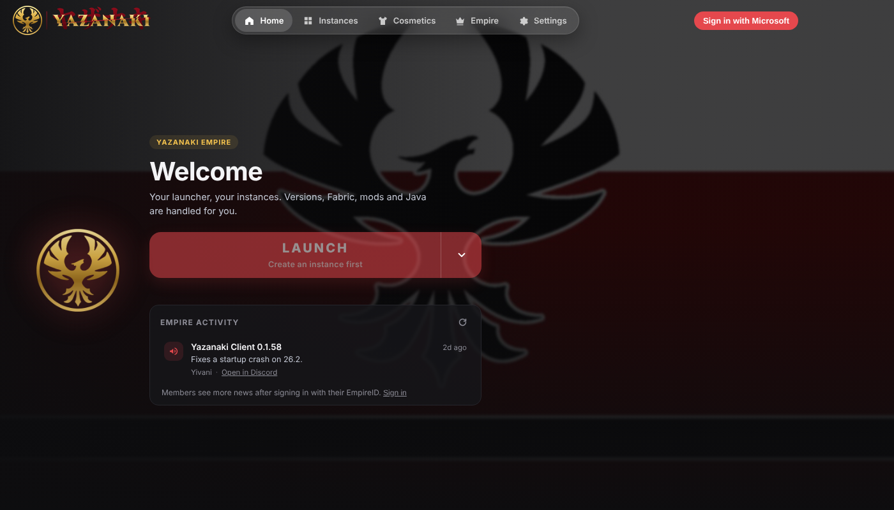
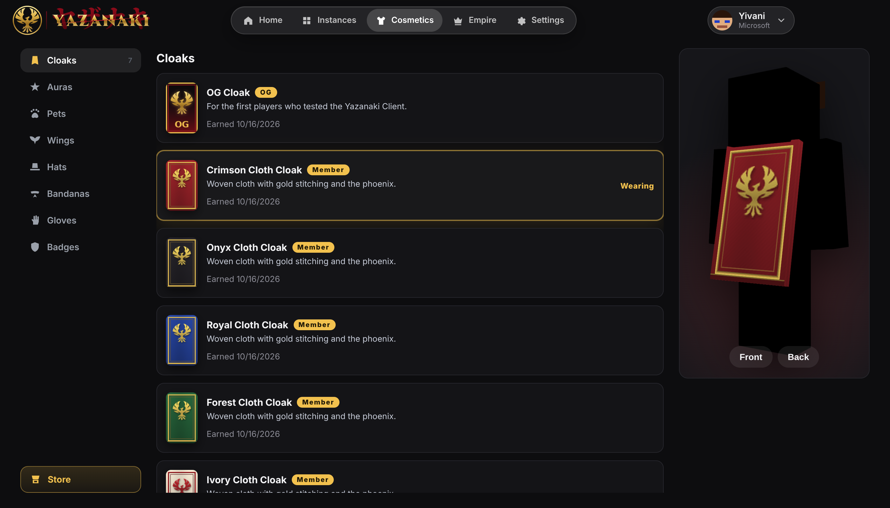
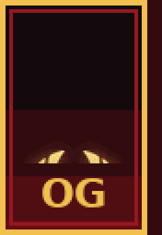
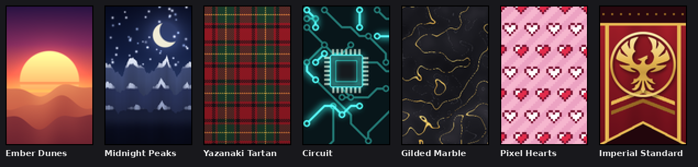
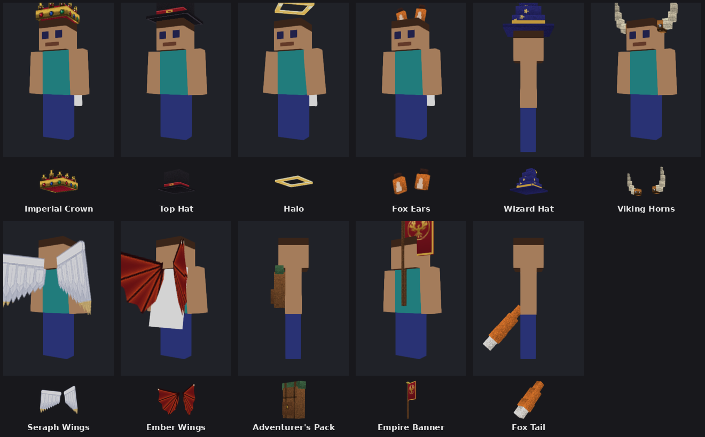
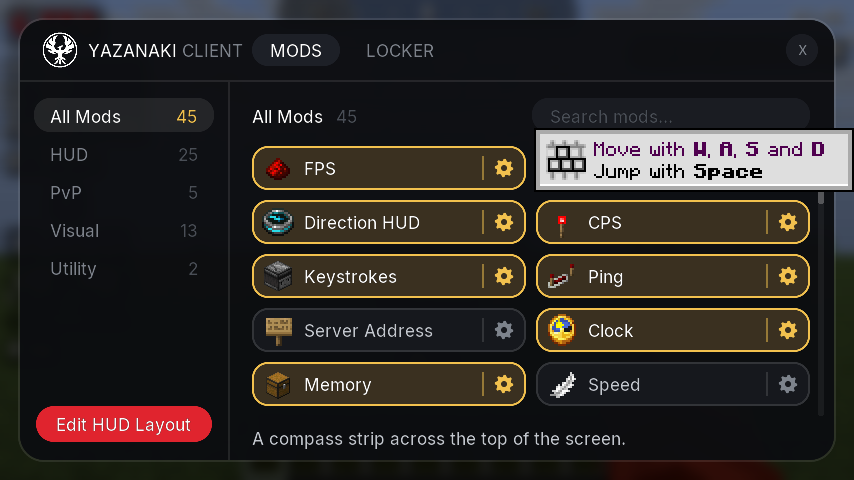
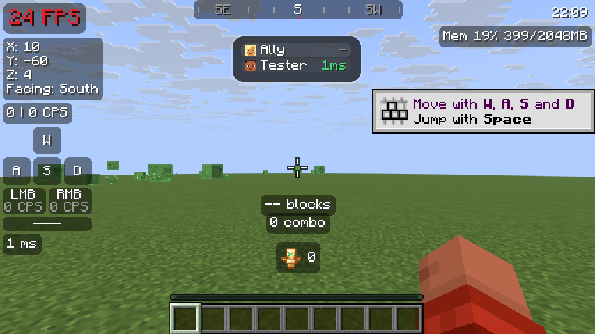
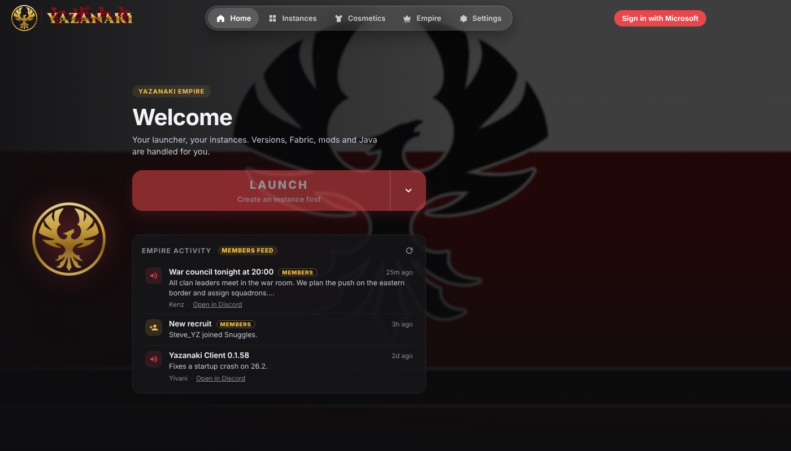

  

<h1 align="center">Yazanaki Client</h1>

  A free Minecraft: Java Edition client with cosmetics, a mod menu and a fast setup, made by the Yazanaki Empire.

## Install

1. **[Download the latest version](https://github.com/Yazanaki/YZNKI-Client-Releases/releases/latest)** and click **Yazanaki-Client-Setup-….exe** under *Assets* (Windows).
2. Open the downloaded file. If Windows says "Windows protected your PC", click **More info**, then **Run anyway**.
3. Click **I Agree** to install, sign in with your Microsoft account, create an instance and press **Launch**.

That's it. The client updates itself: when a new version is out, a **Restart to update** button shows up at the top.

---

## Features

### One button to play

Pick a Minecraft version and press **Launch**. Java, Fabric, the game files and the mods are downloaded and set up for you.

- **Yazanaki Client instances** come with performance mods (Sodium, Lithium, FerriteCore, ImmediatelyFast, EntityCulling and more) and tuned Java settings, so the game runs smoother out of the box.
- **Vanilla instances** stay 100% Mojang.
- Keep as many instances as you like, each with its own version, mods and memory.
- Sign in with Microsoft, or add an offline account with its own name and skin for offline-mode servers. Switch accounts in game without restarting.

### Cloaks and cosmetics

Every player gets the **OG cloak** for playing before version 1.0. Cloaks move like real cloth in game, and anyone using the Yazanaki Client sees what you wear.

  

Hats, wings and back items too. Click any item in the store to try it on before you buy it.

### Mod menu

Press **Right Shift** in game to open the mod menu: over 40 mods for HUD, PvP, visuals and utility, each with its own settings. Search them, switch them on and off, and drag them around with **Edit HUD Layout**.

FPS, coordinates, keystrokes, CPS, ping, a compass, a clock, memory and more.

### Made for the Empire

Yazanaki members who sign in with their EmpireID get the latest announcements on the Home page, free member cloaks, clan tags and ally highlights in game. Everything else works for everyone, member or not.

### And more

- **Rewind**: save clips of what just happened and watch, edit or export them in a second window while you keep playing.
- **Discord status** that shows the server you're on (you can turn that off).
- **Crash help**: if the game crashes, the launcher tells you why and opens the crash report.
- A small Yazanaki emblem in the tab list next to everyone else who uses the client.

---

## Help

Questions or problems? Ask in the Yazanaki Discord.

Not an official Minecraft product. Not approved by or associated with Mojang or Microsoft. By installing you agree to the [terms of use and privacy notice](TERMS.txt).

Maintainers: see [docs/PUBLISHING.md](docs/PUBLISHING.md) for how releases are published.
